# دليل استخدام تطبيق «مقاطع»

«مقاطع» يجمع دروسك المرئية والصوتية في مكان واحد. تقصّ منها ما تريد بضغطة، وتفرّغها نصًّا عربيًّا دقيقًا، وتكتب فوائدك، ثم تصدّر كل ذلك كتابًا مرتّبًا. كل شيء يعمل على هاتفك نفسه، ويستمرّ في الخلفية.

## ١. التثبيت على أندرويد (مرة واحدة)

لا يحتاج Termux ولا أي أوامر.

1. افتح **github.com/beaconcrest8/maqati/releases** وحمّل الملف الذي ينتهي بـ `arm64-v8a.apk`.
2. افتح الملف واضغط **تثبيت**. إن سألك الهاتف فاسمح بالتثبيت من هذا المصدر.
3. افتح «مقاطع». أول مرة اسمح بثلاثة أشياء: **الملفات**، و**الإشعارات**، و**العمل في الخلفية**.
4. أول تشغيل يجهّز الأدوات في دقيقة تقريبًا، ثم يفتح التطبيق.

### مفتاح التفريغ المجاني (مرة واحدة)

1. افتح **console.groq.com/keys** وسجّل الدخول بحساب Google. لا يحتاج بطاقة.
2. اضغط **Create API Key** وانسخ المفتاح (يبدأ بـ `gsk_`).
3. في «مقاطع»: **⚙️ الإعدادات ← مفتاح Groq**، والصقه. يُحفظ تلقائيًّا.

الحدّ المجاني نحو ساعتين من الصوت كل ساعة، وثماني ساعات يوميًّا. إذا تجاوزته ينتظر التطبيق ثم يكمل وحده.

## ٢. يعمل وحده في الخلفية

1. أثناء التحميل أو القص أو التفريغ يظهر إشعار «مقاطع» فيه التقدم وزر **إيقاف مؤقت**. أطفئ الشاشة أو افتح تطبيقًا آخر، والعمل مستمر.
2. إذا أعدت تشغيل الهاتف تكمل المهام غير المنتهية وحدها، من حيث توقّفت.
3. لإغلاق التطبيق تمامًا: في الإشعار اضغط **إغلاق مقاطع**.
4. في هواتف سامسونج: **الإعدادات ← البطارية ← حدود استخدام الخلفية ← التطبيقات التي لا تدخل وضع السكون أبدًا** وأضف «مقاطع».

## ٣. الاستخدام اليومي

1. اضغط أيقونة **مقاطع**.
2. من يوتيوب مباشرة: اضغط **مشاركة** تحت المقطع ثم اختر **مقاطع**، فيُضاف الدرس إلى المكتبة.
3. دروسك ومقاطعك وتفريغاتك في مجلد **Maqati** في الهاتف (تراه في تطبيق الملفات).

## ٤. المكتبة والمجلدات

في الأسفل تبويبات: **المكتبة**، **المشاريع**، **المهام**، **الإعدادات**. والبحث زرّ 🔎 في أعلى كل صفحة، والمشغّل يبقى عائمًا في أسفل الشاشة وأنت تتنقّل.

- **الكل**: كل ما أضفته. **غير مصنّف**: ما لم تضعه في مجلد.
- **مجلد جديد**: اختر اسمًا وأيقونة ولونًا.
- داخل المجلد: **🎨 تخصيص** لتغيير الاسم والأيقونة واللون، و**📝 فرّغ الكل** لتفريغ كل دروس المجلد مرة واحدة.

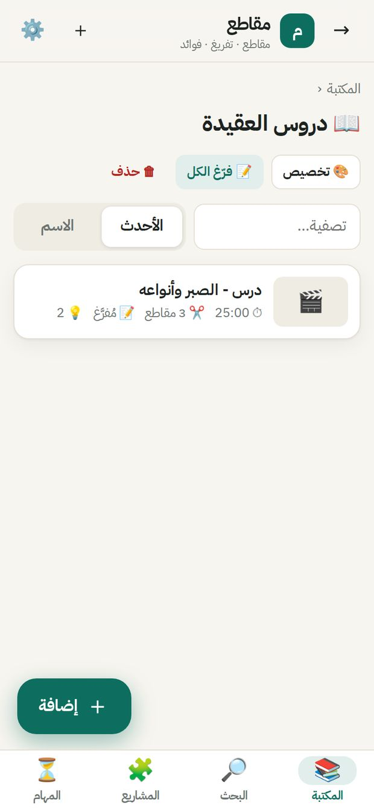

## ٥. إضافة درس

اضغط **＋ إضافة** (الزر العائم أو ＋ في الأعلى).

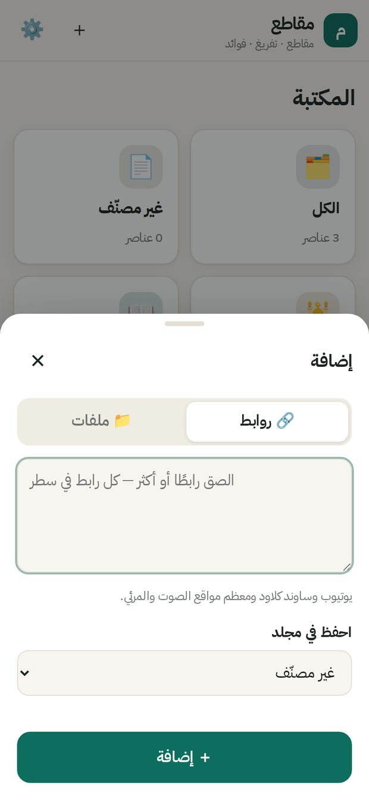

- **روابط**: الصق رابط يوتيوب أو ساوند كلاود أو غيرهما. يمكنك لصق عدة روابط، كل رابط في سطر.
- **ملفات**: اختر فيديو أو صوتًا من الهاتف.
- اختر المجلد الذي يُحفظ فيه ثم اضغط **إضافة**.

## ٦. صفحة الدرس

- اضغط على **العنوان** لتغيير اسمه في أي وقت.
- اضغط على شارة **المجلد** لنقله إلى مجلد آخر.
- الصفحة مقسّمة إلى أقسام: **المقاطع والعلامات**، **التفريغ**، **الفوائد**، **الملفات**، **أدوات**. اضغط عنوان أي قسم لفتحه أو طيّه، ويتذكّر التطبيق اختيارك.

## ٧. العلامات والمقاطع

في أسفل صفحة الدرس شريط ثابت فيه أزرار كبيرة:

- **🔖 علامة**: تحفظ اللحظة الحالية فورًا. تظهر رسالة فيها زرّ **سمِّها** إن أردت تسميتها.
- **🟢 بداية** ثم **🔴 نهاية**: تحدّد مقطعًا. بعد الضغط على «بداية» يعرض الزرّ المدة التي مضت.

عند الضغط على **نهاية** تظهر نافذة صغيرة:

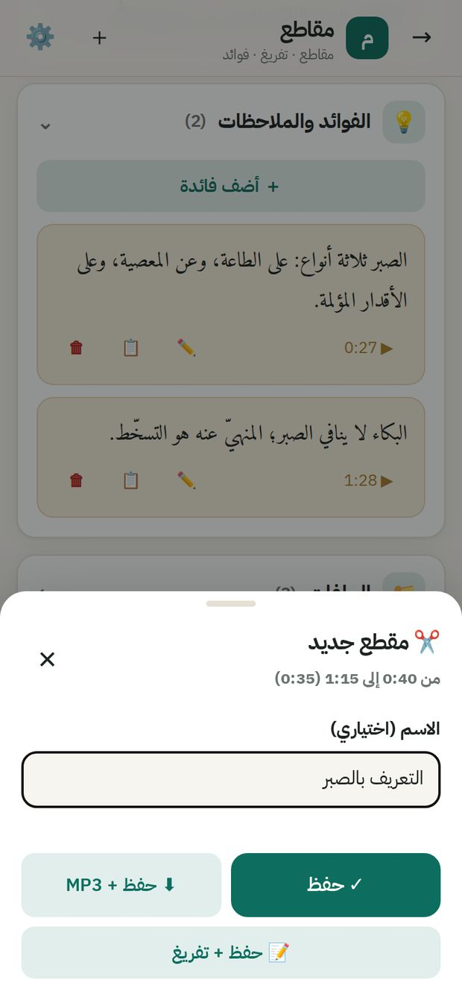

- الاسم اختياري.
- **حفظ**: يحفظ المقطع في القائمة.
- **حفظ + MP3**: يحفظ ويبدأ تنزيل المقطع صوتًا مباشرة.
- **حفظ + تفريغ**: يحفظ ويبدأ تفريغ هذا المقطع وحده.

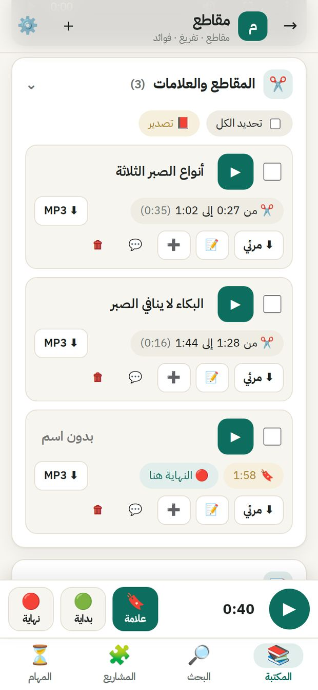

في قائمة المقاطع:

- **▶** يشغّل من بداية المقطع.
- اضغط على **الاسم** لتعديله، وعلى **الوقت** لتعديل البداية والنهاية (أو ⏱ «استخدم الوقت الحالي»).
- للعلامة التي بلا نهاية زرّ **🔴 النهاية هنا**.
- **⬇ MP3** و**⬇ مرئي**: تنزيل المقطع. من يوتيوب يُنزَّل الجزء المطلوب فقط، فيكون سريعًا.
- **📝** تفريغ المقطع، **➕** إضافته إلى مشروع، **💬** ملاحظة على المقطع، **🗑** حذف.
- **تحديد الكل** أو تحديد عدة مقاطع، ثم تنزيلها أو تفريغها معًا دفعة واحدة. تعمل كلها في الخلفية، وأكثر من واحدة في نفس الوقت.

كل مقطع يُحفظ في مجلد الدرس نفسه، داخل مجلد **المقاطع**، باسمه ووقته.

## ٨. التفريغ تحت المشغّل

- **فرّغ الكل** من قسم الأدوات، أو فرّغ مقاطع مختارة فقط.
- أثناء التشغيل تُميَّز الجملة المسموعة وتتحرّك القائمة معها (**تتبّع التشغيل**).
- اضغط على أي جملة لتنتقل إليها في المرئي أو الصوت.
- **✏️ تعديل**: صحّح أي كلمة، ثم **حفظ التعديل**. تُحدَّث ملفات النص تلقائيًّا.
- إذا كان للدرس أكثر من تفريغ (كامل ومقاطع)، تظهر أزرار في الأعلى للاختيار بينها، و**الكل (مدمج)** يجمعها دون تكرار.
- يمكن إخفاء التفريغ من تحت المشغّل: **الإعدادات ← العرض**.

## ٩. الفوائد والملاحظات

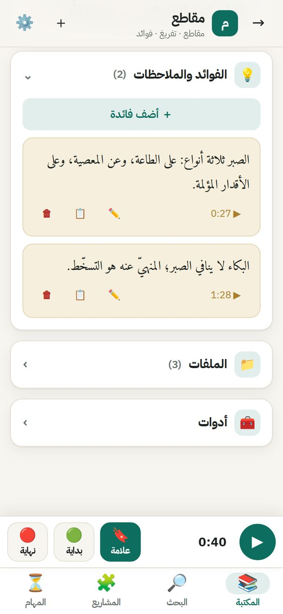

اضغط **＋ أضف فائدة** واكتب ما تشاء:

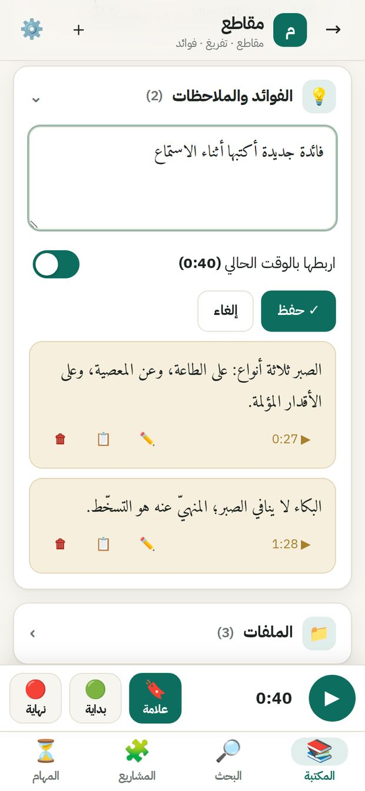

- **اربطها بالوقت الحالي**: تحفظ الفائدة مع لحظتها، ويظهر عليها زرّ ▶ يرجعك إليها.
- ✏️ تعديل، 📋 نسخ، 🗑 حذف.
- الفوائد تدخل في الكتاب عند التصدير (يمكن إلغاؤها).

## ١٠. تصدير كتاب (PDF أو Word)

من قسم التفريغ أو المقاطع أو الأدوات اضغط **📕 تصدير**.

- اكتب **عنوان الكتاب** و**العنوان الفرعي** و**الشيخ أو المؤلف**.
- **المحتوى**: التفريغ الكامل، أو المقاطع (كل مقطع فصل باسمه)، أو الاثنان.
- **التنسيق**: فقرات مرتّبة، أو سطرًا سطرًا.
- **إظهار التوقيت**: مع الأوقات أو بدونها.
- **صفحة غلاف** و**فهرس** و**حجم الخط**.
- **PDF**: تفتح شاشة الطباعة، فاختر **حفظ بتنسيق PDF**. **Word**: ملف تعدّله. **نص**: ملف بسيط.

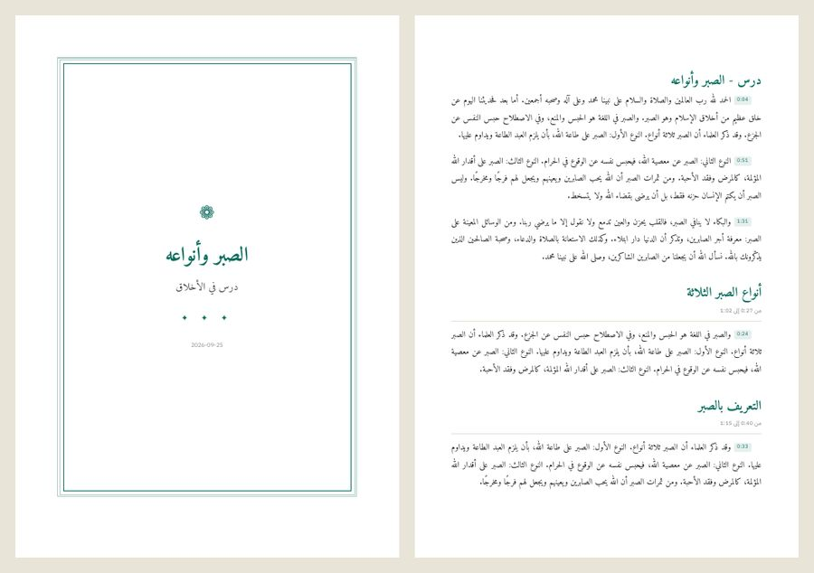

## ١١. البحث عن موضوع في كل الدروس

هذه أداة مشروعك: تجد كل موضع تكلّم فيه الشيخ عن موضوع، في كل الدروس المفرَّغة.

- اكتب الموضوع. افصل الكلمات المتقاربة بفاصلة، مثل: `الصبر، الابتلاء، المصيبة`.
- البحث لا يتأثّر بالتشكيل ولا بفروق الهمزات والتاء المربوطة والألف المقصورة.
- يمكن حصر البحث في مجلد واحد.
- إذا ظهر تنبيه بأن بعض الدروس غير مفرّغة، اضغط **فرّغها الآن**.
- لكل نتيجة: **▶ استمع** يفتح الدرس عند تلك اللحظة، **➕ مشروع** يضيفها إلى مشروع، **🔖 علامة** يحفظها مقطعًا في الدرس.
- **أضف الكل إلى مشروع**: كل النتائج دفعة واحدة.

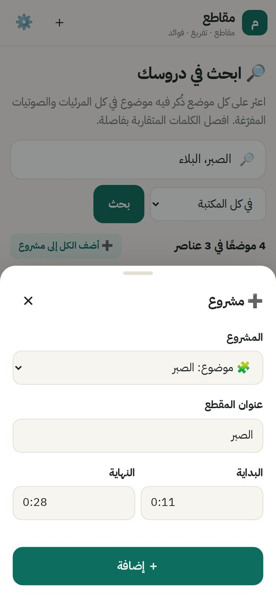

يضيف التطبيق ثواني قبل الموضع وبعده حتى لا تنقطع الجملة. يمكنك تعديل الوقت هنا، أو تغيير عدد الثواني من الإعدادات.

## ١٢. المشاريع

المشروع مجموعة مقاطع عن موضوع واحد من دروس كثيرة.

- غيّر الاسم والوصف في أي وقت.
- لكل مقطع: عنوانه، والدرس الذي جاء منه، ووقته (اضغط لتعديله)، ومقتطف من كلامه، وملاحظتك.
- **▲ ▼** لترتيب المقاطع.
- **⬇ نزّل كل المقاطع (ZIP)**: يقصّ كل المقاطع مرقّمة بعناوينها في مجلد واحد، ومعها كتاب Word ونص لتفريغها، ثم يضغطها في ملف واحد. عند الانتهاء اضغط **جاهز — احفظ ملف ZIP**.
- **📕 تصدير ككتاب**: كتاب PDF أو Word، كل مقطع فيه فصل.

## ١٣. المهام

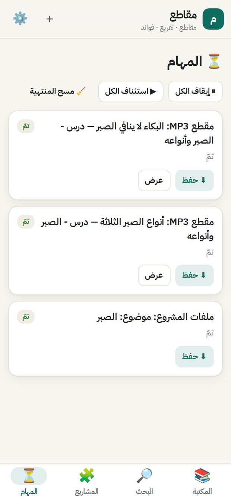

كل تنزيل وتفريغ وتجهيز مشروع يظهر هنا مع نسبة التقدّم.

- **إيقاف** و**استئناف**: يكمل من حيث توقّف، لا من البداية.
- **أعد المحاولة** عند الخطأ.
- **⬇ حفظ** لحفظ الملف الناتج، و**عرض** للانتقال إلى الدرس.
- يمكنك تغيير عدد التنزيلات والتفريغات التي تعمل في نفس الوقت من الإعدادات.

## ١٤. الملفات

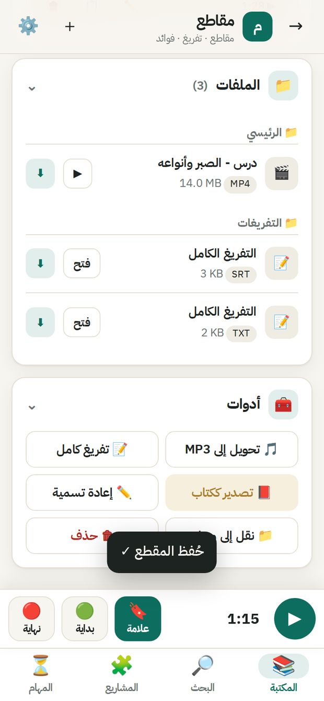

كل ملفات الدرس في قسم **الملفات**: الأصل، ومجلد **المقاطع**، ومجلد **التفريغات** (نص `txt` بالأوقات، وترجمة `srt`). اضغط ▶ للاستماع، أو ⬇ لحفظ الملف على الهاتف.

على الهاتف تجدها أيضًا في تطبيق **الملفات**: **الذاكرة الداخلية ← Maqati ← اسم الدرس**. ومن هناك يمكنك مشاركتها في واتساب أو تيليجرام.

## ١٥. الإعدادات والتخصيص

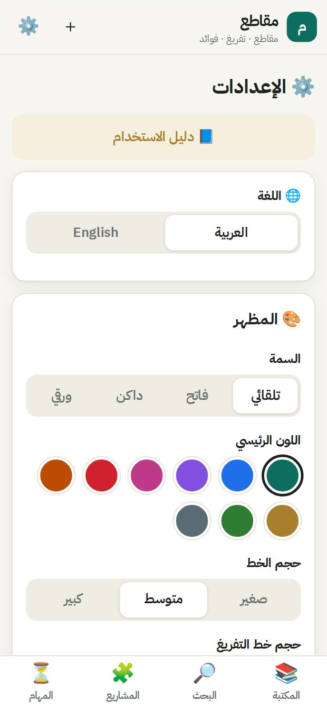

- **اللغة**: العربية أو English.
- **السمة**: تلقائي، فاتح، داكن، ورقي. **اللون الرئيسي**: تسعة ألوان. **حجم الخط** وحجم خط التفريغ.
- **التفريغ**: المفتاح، والنموذج (`whisper-large-v3` الأدقّ)، ولغة الكلام، و**كلمات مساعدة**: أسماء ومصطلحات تتكرّر ليكتبها التفريغ صحيحة.
- **العرض**: إظهار التفريغ تحت المشغّل، وتتبّع الجملة المسموعة.
- **مقاطع البحث**: كم ثانية قبل الموضع وبعده.
- **التنزيل**: عدد المهام في نفس الوقت، وجودة المرئي.

## ١٦. التحديث بلا أوامر

1. يبحث التطبيق عن تحديث وحده مرة في اليوم، ويسألك قبل التثبيت.
2. أو بنفسك: **⚙️ الإعدادات ← التحديث ← ابحث عن تحديث ← تحديث الآن**.
3. أول مرة يطلب الهاتف السماح لـ«مقاطع» بتثبيت التحديثات: فعّله ثم ارجع واضغط تحديث مرة أخرى.
4. مكتبتك ومقاطعك وتفريغاتك وإعداداتك تبقى كما هي.
5. أداة تنزيل يوتيوب تتحدث وحدها كل يوم.

## ١٧. إذا واجهتك مشكلة

| المشكلة | الحلّ |
| --- | --- |
| الصفحة لا تفتح | انتظر دقيقة، أو اضغط «حاول مجددًا». إن تكرر: أغلق التطبيق من الإشعار وافتحه |
| توقّف التنزيل حين أطفأت الشاشة | اسمح لـ«مقاطع» بالعمل في الخلفية: الإعدادات ← التحديث ← «السماح بالعمل في الخلفية» (القسم ٢) |
| تنزيل يوتيوب لم يعد يعمل | الإعدادات ← **تحديث أداة تنزيل يوتيوب** ثم أعد المحاولة |
| «أضف مفتاح Groq» | راجع «مفتاح التفريغ المجاني» في القسم ١ |
| مهمة فيها خطأ | تبويب المهام ← **أعد المحاولة** |
| مقطع مرئي يبدأ قبل الوقت بثانية | طبيعي: المرئي يُقصّ فورًا دون إعادة ترميز. مقاطع MP3 دقيقة تمامًا |
| إصلاح التثبيت | ثبّت آخر نسخة من صفحة Releases فوق القديمة، ولا تُفقد شيئًا |

نزّل فقط ما يحقّ لك الاحتفاظ به من المرئيات. شروط يوتيوب لا تسمح بتنزيل أغلب المرئيات.
