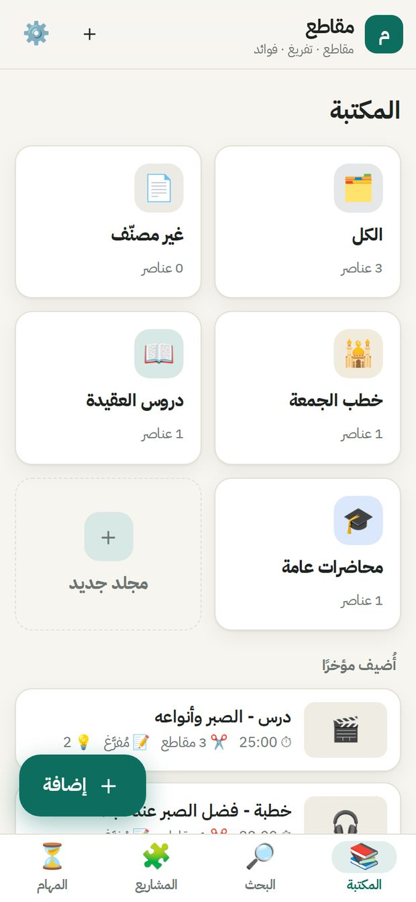
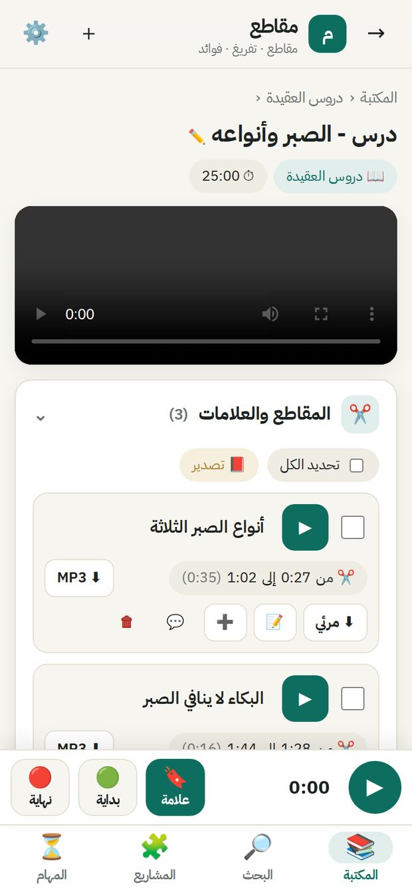
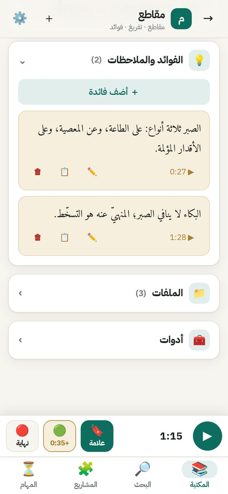
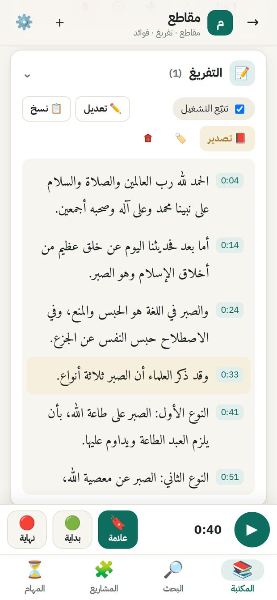
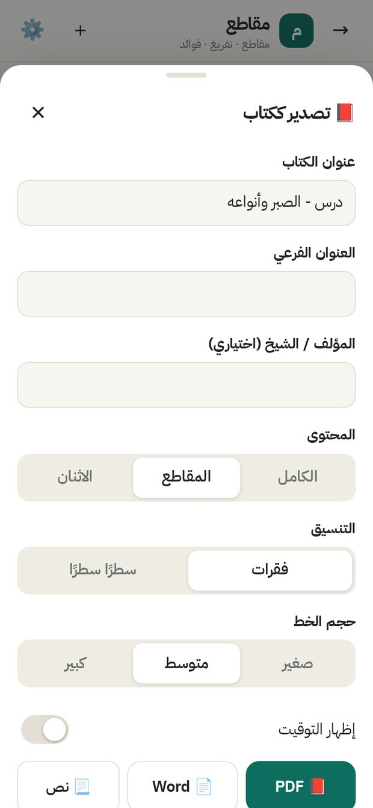
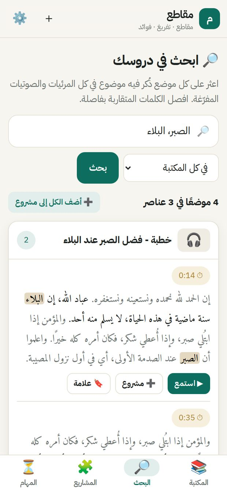
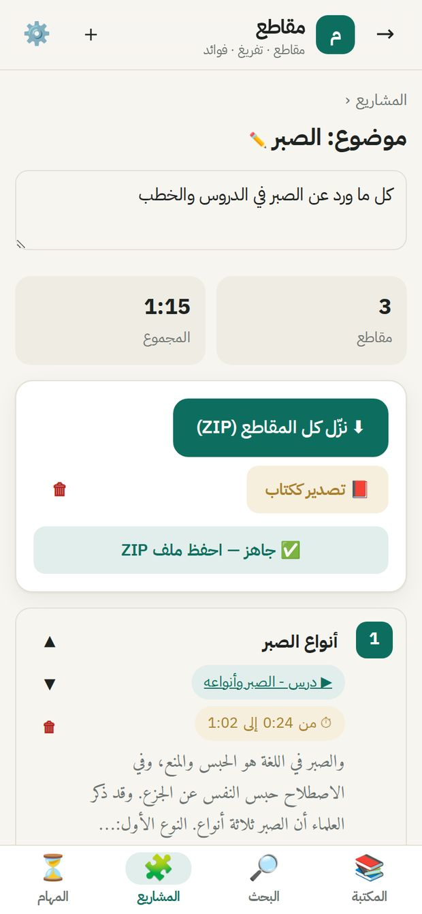

# How to use Maqati

Maqati keeps your video and audio lessons in one place. You can cut any part with one tap, transcribe it into precise Arabic text, write your benefits, and export everything as a well-organised book. It all runs on your own phone and keeps working in the background.

## 1. Install (once)

No Termux, no commands.

1. Open **github.com/agaatworld/Maqatei/releases** and download the file ending in `arm64-v8a.apk`.
2. Open it and tap **Install** (allow installing from this source if asked).
3. Open Maqati. The first time, allow **files**, **notifications** and **background work**. The first start takes about a minute.
4. While something runs, a Maqati notification shows the progress. It keeps working with the screen off; unfinished work continues after a restart.
5. From YouTube: **Share → Maqati** adds the lesson to your library.

## Open from an iPhone or another device

1. In Maqati on your phone: **Settings → Open from an iPhone or another device**, and switch it on.
2. Both on the same Wi-Fi. On the iPhone open the Camera, point it at the square and tap the link.
3. Type the 6-digit code (once).
4. In Safari: **Share → Add to Home Screen**.

**Light and dark:** the moon/sun button at the top switches with one tap.

## 2. Library and folders

- Tabs at the bottom: **Library**, **Search**, **Projects**, **Tasks**.
- **New folder**: pick a name, icon and colour. Inside a folder, **🎨 Customize** changes them and **📝 Transcribe all** transcribes every lesson in it.

## 3. Add

Tap **＋ Add**. Paste one or more links (YouTube, SoundCloud…) or choose files from the phone, and pick the folder.

## 4. A lesson

- Tap the **title** to rename it. Tap the **folder chip** to move it.
- Sections open and close with a tap: **Parts & bookmarks**, **Transcript**, **Benefits & notes**, **Files**, **Tools**.

## 5. Marks and parts

- **🔖 Mark** saves the current moment. **🟢 Start** then **🔴 End** makes a part.
- After End you can name it and choose **Save**, **Save + MP3** or **Save + transcribe**.
- In the list: ▶ play, tap the name or time to edit, **⬇ MP3 / Video**, **📝** transcribe, **➕** add to a project, **💬** note.
- Select several parts to download or transcribe them together. Parts are saved in the lesson's own **parts** folder.

## 6. Transcript under the player

The spoken sentence is highlighted as it plays. Tap any sentence to jump there. **✏️ Edit** fixes words. **📕 Export** makes a book.

## 7. Benefits

Tap **＋ Add a benefit**, write, and optionally link it to the current moment.

## 8. Export as a book

Choose title, subtitle, author, content (full, parts, or both), paragraphs or lines, times on or off, cover and contents page. **PDF** opens the print screen: choose **Save as PDF**. **Word** gives an editable file.

## 9. Search a topic across all lessons

Type the topic. Separate similar words with commas. Spelling differences and diacritics are ignored. From each result: **▶ Listen**, **➕ Project**, **🔖 Mark**.

## 10. Projects

A project collects the parts about one topic from many lessons. Reorder with ▲▼. **Download all clips (ZIP)** cuts them, numbered and named, with a Word book of their transcripts.

## 11. Updating

The app checks for updates once a day and asks before installing. Or: **⚙️ Settings → Update → Find update**. Your library and settings stay as they are. The YouTube downloader updates itself daily.
